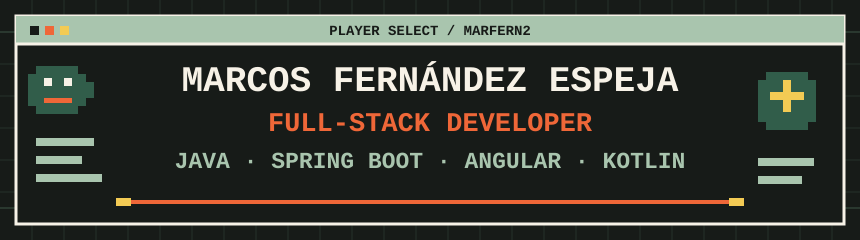

 

 

<picture>
  <source media="(prefers-color-scheme: dark)" srcset="https://readme-typing-svg.demolab.com?font=Fira+Code&amp;size=16&amp;duration=3500&amp;pause=1100&amp;color=F7F2E7&amp;center=true&amp;vCenter=true&amp;width=470&amp;height=32&amp;lines=Java+%2B+Spring+Boot+main%3BBuilding+full-stack+applications%3BAndroid+%C2%B7+Angular+%C2%B7+PostgreSQL%3BLinux+%C2%B7+Docker+%C2%B7+Cloudflare%3BStudent+at+42+Madrid" />
  <source media="(prefers-color-scheme: light)" srcset="https://readme-typing-svg.demolab.com?font=Fira+Code&amp;size=16&amp;duration=3500&amp;pause=1100&amp;color=315D4A&amp;center=true&amp;vCenter=true&amp;width=470&amp;height=32&amp;lines=Java+%2B+Spring+Boot+main%3BBuilding+full-stack+applications%3BAndroid+%C2%B7+Angular+%C2%B7+PostgreSQL%3BLinux+%C2%B7+Docker+%C2%B7+Cloudflare%3BStudent+at+42+Madrid" />
  
</picture>

## PLAYER PROFILE

| Stat | Loadout |
| :--- | :--- |
| **Name** | Marcos Fernández Espeja |
| **Class** | Full-Stack Developer |
| **Main stack** | Java · Spring Boot |
| **Secondary** | Angular · Kotlin · Android |
| **Database** | PostgreSQL |
| **Environment** | Linux |
| **Current quest** | Construir software listo para producción |
| **Portfolio** | [marfern.dev](https://marfern.dev) |

## ABOUT

Soy desarrollador full-stack con foco en backend **Java y Spring Boot**. Me gusta construir aplicaciones completas: APIs, interfaces web y móviles, bases de datos, seguridad y despliegue. En mis proyectos trabajo con Angular, Android/Kotlin, PostgreSQL, Docker, Linux, AWS y Cloudflare. También estudio en **42 Madrid**.

## MAIN QUESTS

### 01 / Donit v1.0.0

Plataforma full-stack de gestión de tareas que evoluciona mi TFG hacia una aplicación completa, con backend, panel web y cliente Android.

`Java` `Spring Boot` `Angular` `Kotlin` `PostgreSQL` `Docker` `Cloudflare`

**Explorar:** [Proyecto](https://marfern.dev/projects/donit) · [Backend](https://github.com/marfern2/tareas-app-api) · [Android](https://github.com/marfern2/tareas-app-front) · [Admin](https://github.com/marfern2/admin-donit)

### 02 / DoNit TFG

Primera versión de Donit, desarrollada como TFG de DAM.

`Spring Boot` `Android` `JavaFX` `PostgreSQL` `AWS EC2` `AWS RDS`

**Explorar:** [Proyecto](https://marfern.dev/projects/donit-tfg)

### 03 / GitHub Trending Radar

Automatización para recopilar tendencias de GitHub mediante scraping con Python y Playwright y exportarlas a CSV.

`Python` `Playwright` `Scraping` `CSV`

### 04 / marfern-portfolio

Este portfolio: una interfaz con estética de videojuego 2D construida en Angular 21 y desplegada con Cloudflare Workers.

`Angular 21` `Cloudflare Workers`

**Explorar:** [Web](https://marfern.dev) · [Repositorio](https://github.com/marfern2/marfern-portfolio)

## TECH INVENTORY

  

| Slot | Herramientas |
| :--- | :--- |
| **Backend** | Java · Spring Boot · Spring Security · REST APIs · JPA · Hibernate · JWT |
| **Frontend** | Angular · TypeScript · HTML · CSS |
| **Mobile** | Kotlin · Android · Jetpack Compose |
| **Data** | PostgreSQL · SQL · Flyway |
| **Infrastructure** | Docker · Linux · AWS · Cloudflare · GitHub Actions |
| **Tools & other** | Git · GitHub · C# · .NET · Python · Playwright |

## PLAYER STATS

  

Las métricas describen la actividad visible en GitHub; no representan nivel de habilidad. [Ver perfil y datos actuales](https://github.com/marfern2).

## CONTRIBUTION GRAPH

  

## CONTRIBUTION SNAKE

  <picture>
    <source media="(prefers-color-scheme: dark)" srcset="https://raw.githubusercontent.com/marfern2/marfern2/output/github-contribution-grid-snake-dark.svg" />
    <source media="(prefers-color-scheme: light)" srcset="https://raw.githubusercontent.com/marfern2/marfern2/output/github-contribution-grid-snake.svg" />
    
  </picture>

## CURRENT QUESTS

- Estudiar en **42 Madrid**.
- Mejorar arquitectura backend, testing y seguridad.
- Seguir evolucionando **Donit**.
- Automatizar tareas con **Playwright**.

## PORTALS

[Portfolio →](https://marfern.dev) · [GitHub →](https://github.com/marfern2)

GAME SAVED. SEE YOU IN THE NEXT COMMIT.

