

 

 

<picture>
  <source media="(prefers-color-scheme: dark)" srcset="https://readme-typing-svg.demolab.com?font=Fira+Code&amp;size=16&amp;duration=3500&amp;pause=1100&amp;color=F7F2E7&amp;center=true&amp;vCenter=true&amp;width=470&amp;height=32&amp;lines=Java+%2B+Spring+Boot+main%3BBuilding+full-stack+applications%3BAndroid+%C2%B7+Angular+%C2%B7+PostgreSQL%3BLinux+%C2%B7+Docker+%C2%B7+Cloudflare%3BStudent+at+42+Madrid" />
  <source media="(prefers-color-scheme: light)" srcset="https://readme-typing-svg.demolab.com?font=Fira+Code&amp;size=16&amp;duration=3500&amp;pause=1100&amp;color=315D4A&amp;center=true&amp;vCenter=true&amp;width=470&amp;height=32&amp;lines=Java+%2B+Spring+Boot+main%3BBuilding+full-stack+applications%3BAndroid+%C2%B7+Angular+%C2%B7+PostgreSQL%3BLinux+%C2%B7+Docker+%C2%B7+Cloudflare%3BStudent+at+42+Madrid" />
  
</picture>

## PLAYER HUD

  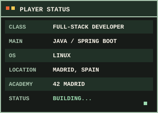

## ABOUT

Soy desarrollador full-stack con foco en backend **Java y Spring Boot**. Me gusta construir aplicaciones completas: APIs, interfaces web y móviles, bases de datos, seguridad y despliegue. En mis proyectos trabajo con Angular, Android/Kotlin, PostgreSQL, Docker, Linux, AWS y Cloudflare. También estudio en **42 Madrid**.

## SYSTEM STATUS

  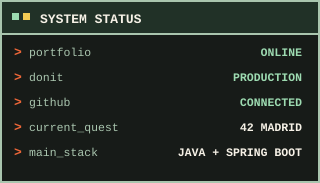

## MAIN QUESTS

  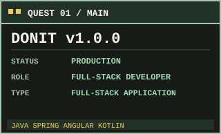

Plataforma de gestión de tareas que evoluciona mi TFG hacia una aplicación completa, con backend, panel web y cliente Android. Stack: Java, Spring Boot, Angular, Kotlin, PostgreSQL, Docker y Cloudflare.

  
   
  
  

  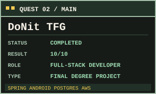

Primera versión de Donit, desarrollada como TFG de DAM con Spring Boot, Android, JavaFX, PostgreSQL y despliegue en AWS EC2 y RDS.

  

  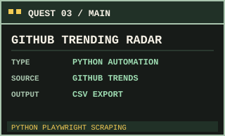

Automatización para recopilar tendencias de GitHub mediante scraping con Python y Playwright y exportarlas a CSV.

  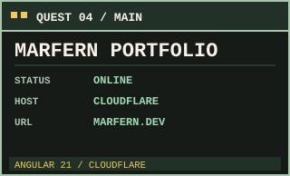

Mi portfolio con estética de videojuego 2D, construido en Angular 21 y desplegado con Cloudflare Workers.

  
  

## TECH INVENTORY

  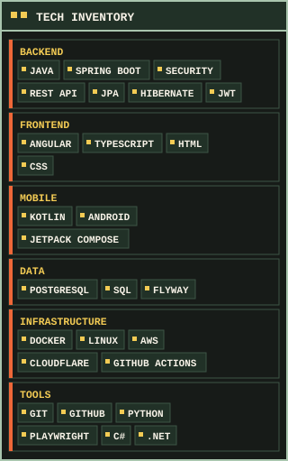

## SKILL TREE

  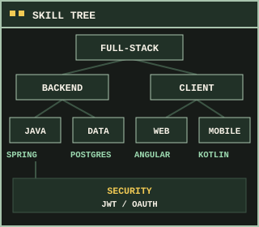

## TERMINAL

  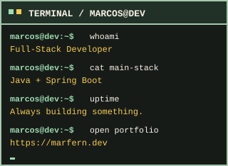

## ACHIEVEMENTS UNLOCKED

  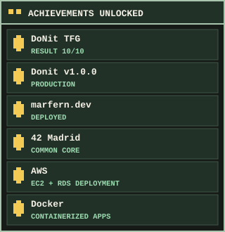

## CURRENT QUEST

  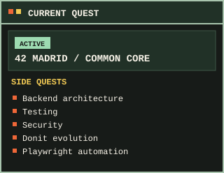

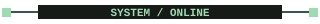

## PLAYER STATS

  

Las métricas describen actividad visible en GitHub; no representan nivel de habilidad.

## ACTIVITY MAP

  

### CONTRIBUTION DUNGEON

  <picture>
    <source media="(prefers-color-scheme: dark)" srcset="https://raw.githubusercontent.com/marfern2/marfern2/output/github-contribution-grid-snake-dark.svg" />
    <source media="(prefers-color-scheme: light)" srcset="https://raw.githubusercontent.com/marfern2/marfern2/output/github-contribution-grid-snake.svg" />
    
  </picture>

## PORTALS

   
  

   

  GAME SAVED. SEE YOU IN THE NEXT COMMIT.

