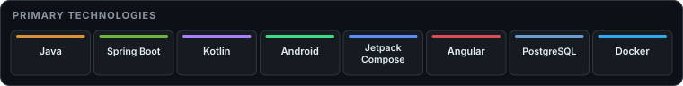

<h1 align="center">Marcos Fernández Espeja</h1>

  <strong>Full-Stack Developer</strong> 
  Java · Spring Boot · Angular · Kotlin · PostgreSQL 
  <a href="https://marfern.dev">Portfolio</a> · <a href="https://github.com/marfern2">GitHub</a>

## About

I build full-stack applications with a focus on **Java and Spring Boot**: backend APIs, Angular frontends, Kotlin/Android clients, and deployment with PostgreSQL, Docker, Linux, AWS, and Cloudflare. I study at **42 Madrid**.

> **Current focus** 
> Java / Spring Boot backend architecture · native Android with Kotlin / Jetpack Compose · testing, security and deployment · 42 Madrid Common Core.

## GitHub dashboard

  <picture>
    <source media="(prefers-color-scheme: dark)" srcset="https://raw.githubusercontent.com/marfern2/marfern2/output/dashboard-dark.svg" />
    <source media="(prefers-color-scheme: light)" srcset="https://raw.githubusercontent.com/marfern2/marfern2/output/dashboard-light.svg" />
    
  </picture>
  <picture>
    <source media="(prefers-color-scheme: dark)" srcset="https://raw.githubusercontent.com/marfern2/marfern2/output/languages-dark.svg" />
    <source media="(prefers-color-scheme: light)" srcset="https://raw.githubusercontent.com/marfern2/marfern2/output/languages-light.svg" />
    
  </picture>

Live public GitHub data · 84-day activity window · language share measures code bytes in public, non-fork repositories, not skill level. See the <a href="https://github.com/marfern2">GitHub profile</a> if an image is unavailable.

## Core stack

  <picture>
    <source media="(max-width: 600px)" srcset="assets/core-stack-mobile.svg" />
    
  </picture>

## Technologies & tools

**Backend** ·  Java ·  Spring Boot · Spring Security ·  JPA / Hibernate · Flyway
**Frontend** ·  Angular ·  TypeScript ·  HTML ·  CSS
**Mobile** ·  Kotlin ·  Android ·  Jetpack Compose
**Data** ·  PostgreSQL · SQL
**Infrastructure** ·  Docker · Linux · AWS ·  Cloudflare
**Tools** ·  Git · GitHub ·  GitHub Actions ·  Playwright

## Featured projects

- **[Donit v1.0.0](https://marfern.dev/projects/donit)** — Full-stack task management platform. Java · Spring Boot · Angular · Kotlin · PostgreSQL · Docker · Cloudflare. [API](https://github.com/marfern2/tareas-app-api) · [Android](https://github.com/marfern2/tareas-app-front) · [Admin](https://github.com/marfern2/admin-donit).
- **[DoNit TFG](https://marfern.dev/projects/donit-tfg)** — Final Degree Project, **10/10**. Spring Boot · Android · JavaFX · PostgreSQL · AWS EC2/RDS.
- **[Portfolio](https://marfern.dev)** — Angular 21 + Cloudflare Workers. [Source](https://github.com/marfern2/marfern-portfolio).
- **GitHub Trending Radar** — Python · Playwright · scraping · CSV · browser automation. Public repository pending.

## Activity

  <picture>
    <source media="(prefers-color-scheme: dark)" srcset="https://raw.githubusercontent.com/marfern2/marfern2/output/github-contribution-grid-snake-dark.svg" />
    <source media="(prefers-color-scheme: light)" srcset="https://raw.githubusercontent.com/marfern2/marfern2/output/github-contribution-grid-snake.svg" />
    
  </picture>

## Contact

[marfern.dev](https://marfern.dev) · [github.com/marfern2](https://github.com/marfern2)
